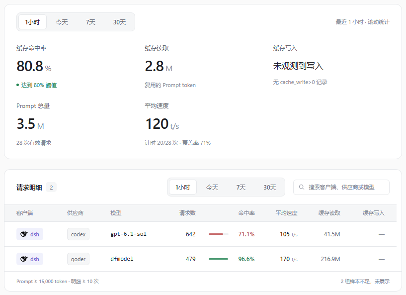

# Magpie 插件仓库

Magpie 的插件合集：每个插件有自己的源码仓库，这里用 submodule 索引、统一校验。当前已核对 **Magpie 0.1.1989**。

| 插件 | 版本 | 功能 | 说明 |
| --- | --- | --- | --- |
| `magpie-cache-guard` 缓存看守 | 0.8.7 | 按供应商 / 客户端 / 模型统计命中率，连续低命中告警；含 Magpie 内嵌看板与设置 | [源码与安装仓库](https://github.com/x-mug/magpie-cache-guard) · [使用说明](https://github.com/x-mug/magpie-cache-guard/blob/main/README.md) |



截图使用合成测试数据。

## 安装

在 Magpie 的 **Plugins → 添加插件** 输入 `github:x-mug/magpie-cache-guard`，或在 **Discover → Unofficial, on GitHub** 搜索 `magpie-cache-guard`。命令行也可安装：

```sh
magpie plugin add github:x-mug/magpie-cache-guard
```

装的是插件仓库 `x-mug/magpie-cache-guard`，它的根目录就是插件。**本仓库是合集工具包，不能当作插件安装。** 阈值、通知、忽略组、刷新周期都在 Magpie 页面内调整；离线安装包见插件仓库的 Releases。

## 仓库结构

```text
plugins/
  magpie-cache-guard/        # submodule → github.com/x-mug/magpie-cache-guard
scripts/verify.mjs           # 逐个插件跑语法、后端与页面约束检查
scripts/check-packages.mjs   # 打包并校验包内容与 SHA256
.github/workflows/ci.yml     # 递归 checkout 后跑上面两项，Windows 另跑浏览器回归
.github/workflows/sync-submodules.yml # 每天把 submodule 指到插件仓库最新提交
```

## 为什么用 submodule

Magpie 装插件认的是「仓库根目录就是插件」，所以每个插件必须有自己根即插件的仓库；合集仓库没法直接装其中某个插件，也不该复制一份代码去同步。submodule 让这里既能 `git clone --recursive` 拿到全部源码、统一跑校验，又不存在需要维护的镜像仓库。

克隆记得带 `--recursive`，否则 `plugins/` 下是空目录，`node scripts/verify.mjs` 会直接报缺文件。已经普通克隆过的补一次：

```sh
git submodule update --init --recursive
```

## 日常怎么改

1. 在插件仓库改代码并升版本：`package.json` 的 `version`、`page/index.html` 的 `data-build` 与 `#build` 徽章，三处必须一致，插件的 `tools/verify.mjs` 会校验；
2. 推插件仓库 `main`：它的 CI 通过后，`Publish release` 按版本打 `v<版本>` tag 并发 Release（`.tgz` 与 `SHA256SUMS.txt`）；
3. 本仓库的 `Update submodules` 每天把 submodule 指到插件仓库最新提交，也可以本地 `git submodule update --remote` 手动提交一次。

本仓库不发 Release、不打版本 tag，发布物全部来自插件仓库。Releases 里只保留迁移前的历史版本 `v0.8.0` / `v0.8.1` / `v0.8.6`。

## 开发和验证

需要 **Node.js 24**，核心验证不需要第三方依赖：

```sh
git clone --recursive https://github.com/x-mug/magpie-plugins.git
cd magpie-plugins
node scripts/verify.mjs
```

页面验证使用已安装的 Chrome / Edge，运行脚本会创建独立的无头浏览器配置和合成数据，不读取用户账本、不操作已安装的 Magpie 插件：

```sh
node plugins/magpie-cache-guard/verification/run-browser.mjs --browser /path/to/chrome
```

打包并校验，顺带生成 `dist/SHA256SUMS.txt`：

```sh
mkdir dist
(cd plugins/magpie-cache-guard && npm pack --ignore-scripts --pack-destination ../../dist)
node scripts/check-packages.mjs
```

本机另可选择只读账本对账和与 Magpie EXE 的测速函数对照，见 [验证说明](https://github.com/x-mug/magpie-cache-guard/blob/main/verification/README.md)。这些不属于默认 CI。

## 数据与兼容性

- 插件只读 Magpie 用量账本，不发送模型请求；页面只保存本插件选项。生成的页面状态和告警保留在用户本机，不进入源码或安装包。
- 命中率按 Prompt token 加权；测速遵循已核对的 Magpie 0.1.1989 计时规则，显示有效样本数与覆盖率。宿主升级后可重新对照。
- 概览和明细的时间范围按钮双向同步；1 小时为滚动窗口，今天从本机零点起算。
- 源码与运行时文件采用 MIT；第三方图标的许可与归属见 [图标说明](https://github.com/x-mug/magpie-cache-guard/blob/main/page/icons/README.md)。
